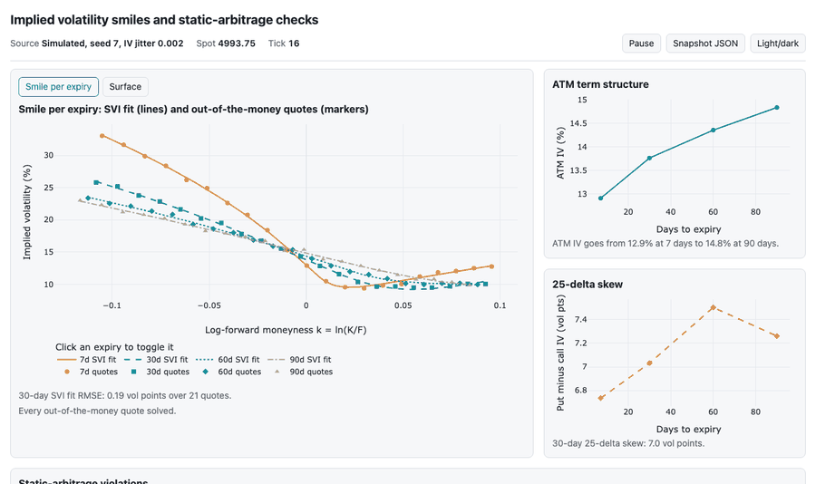

# Volatility Scanner

Streams an option chain over a WebSocket, backs out Black-Scholes implied volatility for every quote, fits an SVI smile to each expiry, and flags quotes that break static no-arbitrage, in a browser dashboard.



The static report, built from one seeded tick, is [docs/index.html](docs/index.html) ([screenshot](docs/img/report.png)). Open it in a browser; it loads Plotly from its CDN and needs nothing else.

## Quickstart

Python 3.12 or newer.

```bash
python3 -m venv .venv && .venv/bin/pip install -e ".[dev]"
.venv/bin/python main.py
```

Then open http://127.0.0.1:8000. `make setup` does the install and also downloads Chromium for the browser tests.

Options for `main.py`:

| Flag | Default | Meaning |
|---|---|---|
| `--seed` | 7 | simulator seed |
| `--jitter` | 0.002 | IV noise per simulated quote, as a standard deviation (0.002 = 0.2 vol points); 0 gives clean prices |
| `--tick-size` | none | round simulated prices to this increment, for example 0.05 |
| `--source` | simulated | `yfinance` for real quotes (see below) |
| `--port`, `--host` | 8000, 127.0.0.1 | |

`uvicorn main:app` also works and uses the defaults.

## How it works

**Data.** `simulator.py` generates calls and puts on 21 strikes (4,500 to 5,500, step 50) and four expiries (7, 30, 60, 90 days) around a spot near 5,000, with r = 5% and no dividends. Each expiry's smile is a slice of an SSVI surface (Gatheral and Jacquier 2014) with rho near -0.7, so out-of-the-money puts are richer than calls, and ATM vol rising from about 13% at 7 days to about 15% at 90 days. Spot, the ATM level and rho drift slowly from tick to tick. The true surface is free of butterfly and calendar arbitrage by construction (eta (1 + |rho|) <= 2, gamma = 0.5). Each quote then gets independent IV noise (`--jitter`), and its call and put are priced from the same noisy vol.

**IV solver** (`engine.py`). For each quote:

1. Reject what has no answer, with a reason code: `invalid_input` (non-finite or non-positive S, K, T), `zero_price`, `at_or_below_intrinsic` (price <= max(0, S e^{-qT} - K e^{-rT}) for a call), `above_upper_bound` (price >= S e^{-qT} for a call; the put bounds mirror these).
2. Start from the Brenner-Subrahmanyam guess sigma = price / (S e^{-qT}) * sqrt(2 pi / T), clamped to the bracket [1e-4, 5].
3. Take Newton steps on vega. If a step leaves the bracket, vega falls below 1e-8 S, or 50 steps pass, switch to Brent's method on the bracket (`outside_bracket` if the bracket holds no root).

It never returns an unconverged iterate; failures are NaN in Python and `null` in the JSON, and the dashboard lists them with their reason. `implied_volatility_array` runs the Newton steps for the whole chain as NumPy arrays and sends the remainder to Brent one quote at a time.

**SVI fit** (`svi.py`). Per expiry, on out-of-the-money quotes (puts below the forward, calls above), raw SVI total variance

w(k) = a + b (rho (k - m) + sqrt((k - m)^2 + s^2)),  k = ln(K / F)

is fit by bounded least squares (`scipy.optimize.least_squares`) with b in [0, 1], |rho| <= 0.999, s > 0, and a + b s sqrt(1 - rho^2) >= 0. The b <= 1 bound keeps the wing slope b (1 + |rho|) under Roger Lee's limit of 2. Residuals are weighted by vega, floored at 5% of the largest vega so the 7-day wings still count. The fit reports RMSE in vol points, the Gatheral-Jacquier density g(k) >= 0 on 201 points of k in [-1, 1], and calendar crossings between fitted slices. ATM IV is the fit at k = 0; 25-delta skew is the fitted IV at the 25-delta put minus the 25-delta call, in vol points.

**Arbitrage checks** (`engine.py`, `scan_arbitrage`), one expiry at a time on mid prices:

| Check | Condition |
|---|---|
| monotonicity | call price does not rise with strike |
| slope | C(K1) - C(K2) <= e^{-rT} (K2 - K1) |
| butterfly | (K3 - K2) C(K1) - (K3 - K1) C(K2) + (K2 - K1) C(K3) >= 0, for uneven strike spacing |
| calendar | total variance sigma^2 T does not fall with T at fixed log-forward moneyness, interpolated linearly in k |
| parity | C - P = S e^{-qT} - K e^{-rT}, where both legs exist |

Every violation carries its type, expiry, strikes and size in dollars (for calendar: how far the longer call sits below the price that keeps its total variance at the shorter expiry's level). Violations under the tolerance (1e-6 simulated, $0.005 live) are not reported. With real quotes, `exceeds_spread` says whether the size is larger than the legs' summed half-spreads.

**What the simulated flags mean.** With the default jitter of 0.002, the scanner flags 8 to 21 butterfly violations per tick (mean 13.5 over the first 200 ticks of seed 7; 11 on the report tick). These are correct: independent noise per strike makes some quoted call prices non-convex in strike, and a butterfly on those quotes would earn money at no risk. They come from the noise, not the model; `--jitter 0` gives 0 violations, which the browser tests check. Parity never fires in simulated mode because each strike's call and put share one vol.

**Server** (`main.py`). One background task ticks the source every 0.5 s, builds the payload in a worker thread (about 60 ms: IVs, four SVI fits, the checks), and puts it in a one-slot outbox per client. A client that falls behind skips to the newest tick instead of queueing old ones, so a stalled browser cannot hold up the others or grow memory. Each payload has a tick id. If a tick fails, clients get an error message and the page keeps the last good tick, marked stale. `GET /snapshot.json` returns the latest tick: quotes, IVs, reason codes, SVI parameters and violations.

**Dashboard.** The smile per expiry is the main view: SVI fit as lines, quotes as markers, failed solves as hollow markers on the fitted curve and listed below the chart. The second tab draws the SVI surface. Side charts show ATM term structure and 25-delta skew. The arbitrage table sorts by size; clicking a row rings its strikes on the smile. The page follows the system light or dark setting (with a toggle), uses the Okabe-Ito palette plus dash patterns and marker shapes, and stacks to one column under 700 px. Pause freezes the view.

## Results

From `python report.py --seed 7 --out docs/index.html` (simulated data, seed 7, IV jitter 0.002), run on arm64 Darwin 27.0.0 with Python 3.15.2. `docs/report.json` holds every number.

SVI fit on the first tick:

| Expiry (days) | RMSE (vol points) | ATM IV | 25-delta skew (vol points) |
|---:|---:|---:|---:|
| 7 | 0.18 | 13.21% | 6.90 |
| 30 | 0.15 | 13.82% | 6.82 |
| 60 | 0.16 | 14.56% | 7.29 |
| 90 | 0.16 | 14.92% | 7.33 |

The noise is 0.2 vol points, so these RMSEs are at the noise level. On ±10% strikes the raw parameters rho, m and s trade off against each other; `tests/test_svi.py` states the per-parameter tolerances (rho within 0.5 under noise, within 1e-3 without) and checks the fitted smile, ATM IV and skew more tightly, including on held-out strikes.

IV round trip: 10,000 random contracts (S 50 to 5,000, K/S 0.5 to 2, T 1 day to 2 years, sigma 5% to 200%, q 0 to 5%, calls and puts). 9,602 have vega above 1e-4 S, where sigma is identifiable from the price; all 9,602 solve, with a largest error of 2.9e-12 and a median of 2.2e-16.

Solver benchmark (`python bench/bench_iv.py`, median of 5 runs, equity-like contracts with K/S 0.7 to 1.3):

| Options | Scalar loop (ms) | Vectorized (ms) | Speed-up | Brent fallback |
|---:|---:|---:|---:|---:|
| 1,000 | 4.8 | 2.7 | 1.8x | 12.0% |
| 10,000 | 46.2 | 24.8 | 1.9x | 12.8% |

The vectorized solver matches the scalar one to 1e-10 wherever vega is above 1e-4 S. Its gain is small because about 12% of quotes, mostly far out of the money where the starting guess has almost no vega, still go through the scalar Brent fallback. numba is not used.

## Real data mode

```bash
.venv/bin/pip install -e ".[live]"
.venv/bin/python main.py --source yfinance --symbol SPY --rate 0.05
```

This downloads calls and puts for the three nearest expiries every 30 seconds (each chain takes a few seconds) and pushes to the page only when quotes change. It keeps strikes within 10% of spot, drops quotes with no bid or a crossed market, prices at the mid, and measures time to expiry to 16:00 New York time on the expiry date. The carry comes from put-call parity at the strike nearest spot: F = K + e^{rT} (C - P), q = r - ln(F / S) / T. The rate is whatever you pass; the 0.05 default is a placeholder, so pass the current 3-month Treasury bill yield. Yahoo quotes are delayed and sometimes stale, and yfinance data is for personal use under Yahoo's terms; do not commit downloaded chains.

## Limitations

- Black-Scholes is a European model. SPY options are American, so deep in-the-money puts carry early-exercise value this ignores.
- One flat rate for every expiry.
- Live quotes are delayed mids; a "violation" on stale quotes may not have been tradable.
- The default mode is simulated; its arbitrage flags come from the added noise.

## Development

```bash
make lint   # ruff check, ruff format --check, mypy
make test   # unit tests and Playwright browser tests (tests/e2e, marked e2e)
.venv/bin/pytest -m "not e2e"   # without a browser
.venv/bin/python scripts/capture_screens.py   # regenerate docs/img after report.py
```

The browser tests need Chromium (`playwright install chromium`) and network access to the Plotly CDN. CI runs all of it on Python 3.12 and 3.13.

## Related

[quantsim](https://github.com/allenwang0/quantsim) links here for option pricing and implied volatility.

No license has been chosen yet.
