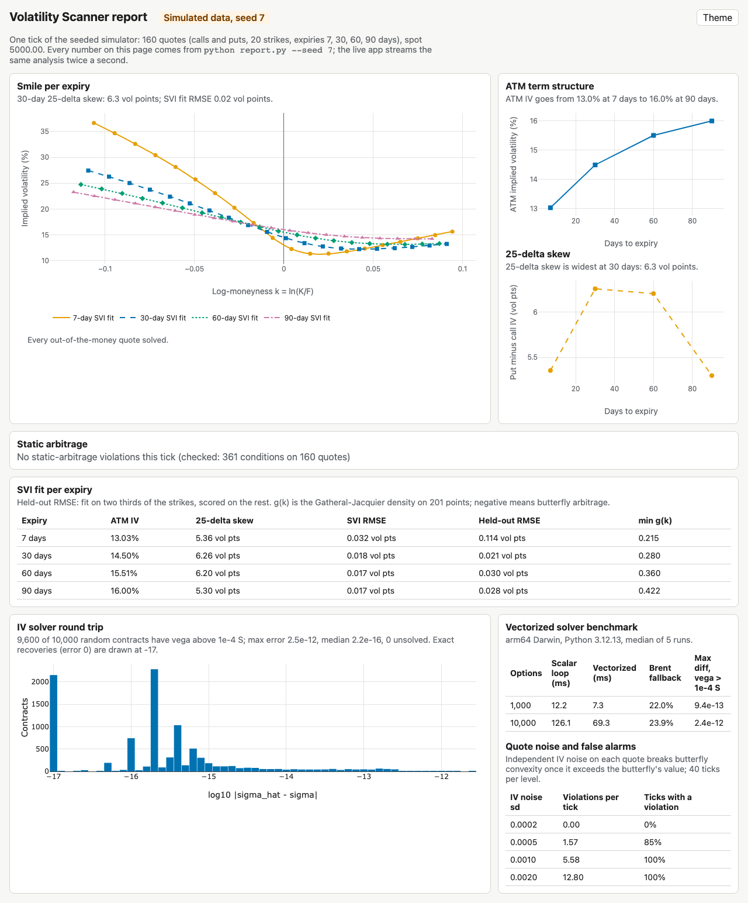
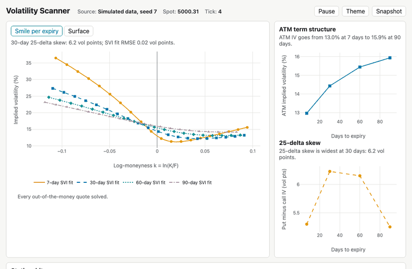

# Volatility Scanner

Streams an option chain, backs out Black-Scholes implied volatility for every quote, fits an SVI smile per expiry, and flags quotes that break static no-arbitrage, in a FastAPI app with a live Plotly dashboard.





The report above is [docs/index.html](docs/index.html), built by `python report.py --seed 7`. `.github/workflows/pages.yml` rebuilds it for GitHub Pages at https://allenwang0.github.io/volatilityscanner/.

## Quickstart

Needs Python 3.11 or 3.12.

```bash
git clone https://github.com/allenwang0/volatilityscanner.git
cd volatilityscanner
make setup PYTHON=python3.12
.venv/bin/python main.py --seed 7
```

Open http://127.0.0.1:8000. `make setup` creates `.venv`, installs the package with its dev tools, and downloads Chromium for the browser tests. `.venv/bin/uvicorn main:app` also works and runs the simulator without a fixed seed.

Other commands:

```bash
make test                                    # unit tests
make e2e                                     # Playwright browser tests (they start the server)
make lint                                    # ruff, ruff format --check, mypy
.venv/bin/python report.py --seed 7 --out docs/index.html --card site/card.json
.venv/bin/python -m bench.bench_iv           # scalar vs vectorized IV benchmark
```

## How it works

### Data

By default the chain is simulated and fully offline (`simulator.py`). It prices calls and puts at 20 strikes from 4500 to 5500 and expiries of 7, 30, 60 and 90 days. Prices come from raw SVI smiles with negative rho (put skew) and ATM volatility rising from 13% at 7 days to 16% at 90 days. Each tick, spot takes a random-walk step, the whole surface scales with a slow mean-reverting level, and each quote gets independent IV noise (sd 0.0002 by default, `--noise-sd` to change it). `--seed` makes a run reproducible, and `--tick-size 0.05` rounds prices to a tick.

### IV solver

`engine.implied_volatility` returns `IVResult(sigma, converged, iterations, reason)`:

1. Reject prices outside the model-free bounds. For a call, $\max(0, S e^{-qT} - K e^{-rT}) < C < S e^{-qT}$; puts mirror this. The reasons are `zero_price`, `at_or_below_intrinsic`, `above_upper_bound` and `invalid_input`.
2. Start from the Brenner-Subrahmanyam guess $\sigma_0 = \sqrt{2\pi/T}\, C / (S e^{-qT})$, clipped to $[10^{-4}, 5]$.
3. Run Newton steps $\sigma \leftarrow \sigma - (BS(\sigma) - C)/\text{vega}$. If a step leaves the bracket or vega falls below $10^{-8} S$, switch to Brent's method on the bracket.

A failed solve returns NaN with its reason, never an unconverged iterate. The payload sends it as `null`, and the page draws it as a hollow marker on the fit and lists the reason. `engine.implied_volatility_vec` runs the same checks and Newton steps on the whole chain as NumPy arrays and passes any option Newton cannot finish to the scalar solver, which ends on Brent.

### SVI fit

Each expiry's out-of-the-money quotes (puts below the forward, calls above it) are fitted to raw SVI total variance (Gatheral 2004):

$$w(k) = a + b\left(\rho (k - m) + \sqrt{(k - m)^2 + s^2}\right), \quad k = \ln(K/F)$$

The fit is bounded least squares (`scipy.optimize.least_squares`) with $b \ge 0$, $|\rho| < 1$, $s > 0$ and $a + b s \sqrt{1-\rho^2} \ge 0$, weighted by vega (floored at 0.2 of the maximum so short-dated wings still count). It starts from a grid over $(m, s)$, where the other three parameters solve linearly. Each fit reports its RMSE in vol points and the minimum of the Gatheral-Jacquier density $g(k)$ on 201 points; $g < 0$ means butterfly arbitrage. The ATM IV and the 25-delta put-minus-call skew (undiscounted Black deltas) come from the fit. The skew is shown as n/a when a 25-delta strike falls outside the quoted range.

### Static-arbitrage checks

`arbitrage.check_static_arbitrage` checks each expiry separately:

- Call price is non-increasing in strike: $C(K_1) \ge C(K_2)$.
- Slope bound: $C(K_1) - C(K_2) \le e^{-rT}(K_2 - K_1)$.
- Butterfly convexity with uneven spacing: $C(K_2) \le \lambda C(K_1) + (1-\lambda) C(K_3)$, where $\lambda = (K_3-K_2)/(K_3-K_1)$.
- Put-call parity when both legs exist: $C - P = e^{-rT}(F - K)$.
- Calendar: total variance $w = \sigma^2 T$ must not fall with $T$ at fixed $k$. The earlier slice is interpolated linearly in $k$, and an expiry with fewer than two solved quotes is skipped over.

Every violation has a type, expiry, strikes and a size in dollars. With bid and ask quotes, it also says whether the size exceeds the cost of crossing half the spread on every leg. Violations under the tolerance ($10^{-6}$ simulated, half a cent live) are not reported.

### Server

One producer task ticks the source every 500 ms and builds each tick in a worker thread. Every connected WebSocket client has a one-slot outbox, so all clients see the same tick sequence and a stalled client skips to the newest tick. A failed tick is logged with its traceback and the producer carries on. `GET /snapshot.json` returns the latest tick: the chain, IVs, reason codes, SVI parameters and violations.

## Results

From `python report.py --seed 7` (the committed [docs/index.html](docs/index.html)). Data is simulated, seed 7, one tick of 160 quotes.

| Expiry | ATM IV | 25-delta skew | SVI RMSE | Held-out RMSE | min g(k) |
|---:|---:|---:|---:|---:|---:|
| 7 days | 13.03% | 5.36 vol pts | 0.032 vol pts | 0.114 vol pts | 0.215 |
| 30 days | 14.50% | 6.26 vol pts | 0.018 vol pts | 0.021 vol pts | 0.280 |
| 60 days | 15.51% | 6.20 vol pts | 0.017 vol pts | 0.030 vol pts | 0.360 |
| 90 days | 16.00% | 5.30 vol pts | 0.017 vol pts | 0.028 vol pts | 0.422 |

Held-out RMSE fits on two thirds of the strikes and scores the rest. The checks found no violations on that tick (361 conditions on 160 quotes).

IV round trip: of 10,000 random contracts (S 50 to 5000, K/S 0.5 to 2, T up to 2 years, sigma 0.05 to 2, both types), 9,600 have vega above $10^{-4} S$. All 9,600 solve, with a max error of 2.5e-12 and a median of 2.2e-16. The tests also run a 2,000-example hypothesis round trip and a call/put parity property to 1e-8.

Vectorized solver against the scalar loop (arm64 macOS, Python 3.12.13, median of 5 runs):

| Options | Scalar loop | Vectorized | Brent fallback | Max diff where vega > 1e-4 S |
|---:|---:|---:|---:|---:|
| 1,000 | 12.2 ms | 7.3 ms | 22.0% | 9.4e-13 |
| 10,000 | 126.1 ms | 69.3 ms | 23.9% | 2.4e-12 |

The gain is under 2x because about a quarter of these contracts leave the Newton bracket or have tiny vega, and those are solved one at a time by the scalar path.

Quote noise and false alarms (40 ticks per level): independent IV noise breaks butterfly convexity once the price noise it causes exceeds a butterfly's value. On this 52.63-point strike grid the 90-day at-the-money butterfly is worth 1.70 dollars (noiseless, seed 7), and wing butterflies less.

| IV noise sd | Violations per tick | Ticks with a violation |
|---:|---:|---:|
| 0.0002 | 0.00 | 0% |
| 0.0005 | 1.57 | 85% |
| 0.0010 | 5.58 | 100% |
| 0.0020 | 12.80 | 100% |

On a separate fitting test with 41 strikes per expiry and noise sd 0.002, the fit recovers known SVI parameters within a 0.002, b 0.005, rho 0.15, m 0.015 and s 0.025, with RMSE under 0.5 vol points (`tests/test_svi.py`).

## Real data mode

```bash
.venv/bin/pip install -e ".[live]"
.venv/bin/python main.py --source yfinance --symbol SPY
```

This fetches calls and puts for the four nearest expiries from Yahoo Finance through yfinance every 30 seconds and pushes a tick only when prices change. It keeps strikes within 10% of spot and drops quotes with no bid or a crossed market. Mid prices are used for IV, and each expiry's forward comes from put-call parity at the strike nearest spot. Time to expiry runs to the 16:00 New York close. The rate is `--rate`, defaulting to 4.06%: the 3-month Treasury bill rate (FRED series DTB3) on 2026-11-09. If a fetch fails, the page keeps the last good tick, marks it stale and shows the error. Yahoo's quotes are delayed, and outside US market hours most bids are zero, so few quotes survive the filter. yfinance data is for personal use under Yahoo's terms; nothing fetched is saved.

## Limitations

- Black-Scholes is for European options. SPY options are American, so early exercise can move prices, mostly for deep in-the-money puts, and parity holds only approximately.
- One flat rate and no dividend yield in live mode, although SPY pays dividends. The IVs are solved from spot, so they carry that bias; the parity-implied forward is used for log-moneyness and the checks.
- yfinance quotes are delayed and sometimes stale, and strikes on the same expiry may not be quoted at the same moment.
- The default chain is simulated. The report and every number above come from the simulator, not from market data.

## Related

[quantsim](https://github.com/allenwang0/quantsim) is an event-driven and vectorized backtesting project; it links here for option pricing and implied volatility.

## License

MIT, see [LICENSE](LICENSE). The dashboard loads Plotly.js (MIT) from its CDN.
