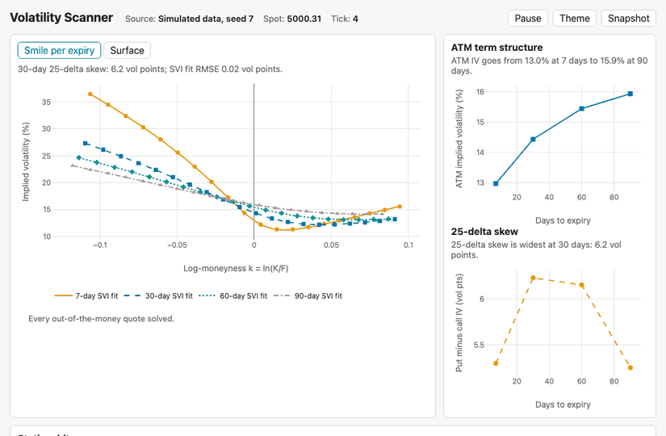

# Volatility Scanner

A live options dashboard: it streams an option chain, works out the implied volatility of every quote, fits a smooth smile per expiry and flags prices that would allow risk-free profit. Everything below is measured on simulated data.

**[Read the report →](https://allenwang0.github.io/volatilityscanner/)**



## Highlights

<!-- results:start -->
- **Implied-volatility solver:** on 10,000 random simulated contracts, all 9,600 with usable vega solve, largest error 2.5e-12. Usable vega (> 0.0001 × spot) means the price still responds to volatility.
- **SVI smile fits** recover the simulated smile to its noise floor: in-sample RMSE 0.017–0.032 vol points against 0.02 points of added noise.
- **5 no-arbitrage checks** (monotonicity, slope, butterfly, put_call_parity, calendar), each sized in dollars and compared with the cost of crossing the bid-ask spread.
- **WebSocket server** ticking every 0.5 s; a slow client skips to the newest update instead of slowing the rest.
<!-- results:end -->

## Run it

```bash
git clone https://github.com/allenwang0/volatilityscanner.git && cd volatilityscanner
make setup PYTHON=python3.12
.venv/bin/python main.py --seed 7
# open http://127.0.0.1:8000
```

## How it works

- A seeded simulator generates the chain by default; `--source yfinance` pulls SPY options instead.
- Each price is inverted through Black–Scholes: bounds checks, a Newton solve, Brent's method as fallback. Failed solves return NaN with a reason code and show as hollow markers.
- Each expiry is fit to an SVI smile, which gives at-the-money volatility and skew.
- The checks cover call monotonicity and slope in strike, butterflies, put-call parity and calendar spreads.
- `scripts/build_report.py` builds the report and these Highlights from `results/`.

## Limitations

- All headline numbers come from the simulator, whose quotes are SVI plus noise, so the fit test is near-circular.
- Black–Scholes assumes European exercise; SPY options are American.
- Yahoo quotes are delayed and not synchronized across strikes.
