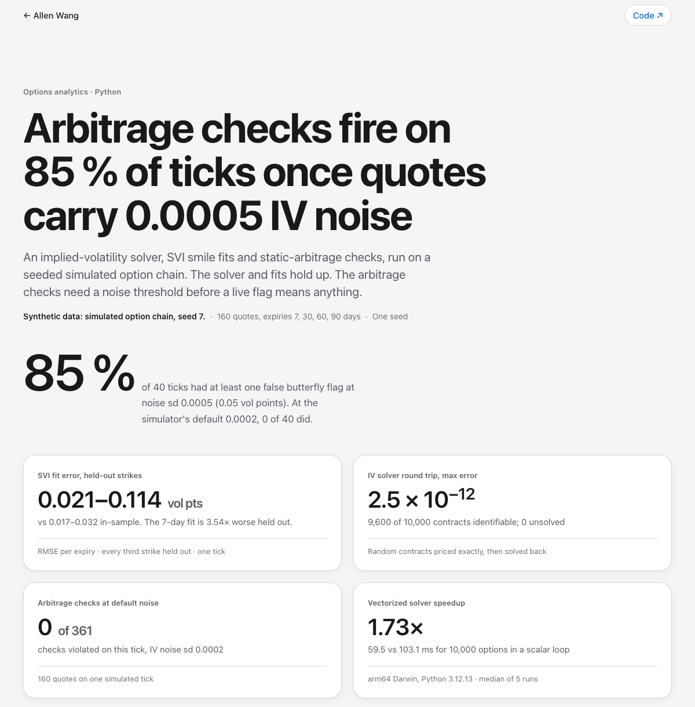

# Volatility Scanner

A live implied-volatility scanner: it streams an option chain, solves Black-Scholes IV for every quote, fits an SVI smile per expiry and flags quotes that violate static no-arbitrage, all in a FastAPI app with a Plotly dashboard that updates twice a second.




Static report: <https://allenwang0.github.io/volatilityscanner/> ([docs/index.html](docs/index.html)).

## Highlights

- **Robust IV solver.** Model-free bounds checks, a Brenner-Subrahmanyam starting guess, Newton steps with a Brent fallback. On 10,000 random contracts, every one with usable vega solves, with max error 2.5e-12.
- **Arbitrage-aware SVI fits** with Gatheral-Jacquier density checks: 0.017 to 0.032 vol points RMSE on the simulated chain.
- **Five static-arbitrage checks** (monotonicity, slope, uneven-spacing butterfly, put-call parity, calendar), each sized in dollars and compared with the cost of crossing the spread.
- **Fan-out WebSocket server** where a stalled client skips to the newest tick instead of slowing everyone else.
- **Offline by default** with a seeded simulator, plus a real-data mode for SPY through yfinance.

## Quickstart

Python 3.11 or 3.12.

```bash
git clone https://github.com/allenwang0/volatilityscanner.git && cd volatilityscanner
make setup PYTHON=python3.12
.venv/bin/python main.py --seed 7
```

Open http://127.0.0.1:8000. Other commands:

```bash
make test                            # unit tests
make e2e                             # Playwright browser tests
.venv/bin/python report.py --seed 7  # rebuild docs/index.html
.venv/bin/python -m bench.bench_iv   # scalar vs vectorized IV benchmark
```

Real data:

```bash
.venv/bin/pip install -e ".[live]"
.venv/bin/python main.py --source yfinance --symbol SPY
```

## How it works

### Data

The default chain is simulated (`simulator.py`): calls and puts at 20 strikes from 4500 to 5500 and expiries of 7, 30, 60 and 90 days, priced from raw SVI smiles with put skew and ATM vol rising from 13% to 16%. Each tick, spot takes a random-walk step, the surface scales with a slow mean-reverting level, and each quote gets independent IV noise (sd 0.0002, `--noise-sd`).

Real-data mode pulls the four nearest SPY expiries every 30 seconds, keeps strikes within 10% of spot and drops quotes with no bid or a crossed market. IV uses mid prices, and each expiry's forward comes from put-call parity at the strike nearest spot. The rate defaults to 4.06% (`--rate`), the 3-month T-bill rate on 2026-11-09. A failed fetch keeps the last good tick and marks it stale.

### IV solver

`engine.implied_volatility` returns `IVResult(sigma, converged, iterations, reason)`:

1. Reject prices outside the model-free bounds. For a call, $\max(0, S e^{-qT} - K e^{-rT}) < C < S e^{-qT}$; puts mirror this. Reasons: `zero_price`, `at_or_below_intrinsic`, `above_upper_bound`, `invalid_input`.
2. Start from the Brenner-Subrahmanyam guess $\sigma_0 = \sqrt{2\pi/T}\, C / (S e^{-qT})$, clipped to $[10^{-4}, 5]$.
3. Run Newton steps $\sigma \leftarrow \sigma - (BS(\sigma) - C)/\text{vega}$. If a step leaves the bracket or vega falls below $10^{-8} S$, switch to Brent's method.

A failed solve returns NaN with its reason, never an unconverged iterate, and the dashboard draws it as a hollow marker. `engine.implied_volatility_vec` runs the same checks and Newton steps on the whole chain in NumPy and hands anything Newton cannot finish to the scalar solver.

### SVI fit

Each expiry's out-of-the-money quotes are fitted to raw SVI total variance (Gatheral 2004):

$$w(k) = a + b\left(\rho (k - m) + \sqrt{(k - m)^2 + s^2}\right), \quad k = \ln(K/F)$$

The fit is bounded least squares with $b \ge 0$, $|\rho| < 1$, $s > 0$ and $a + b s \sqrt{1-\rho^2} \ge 0$, vega-weighted (floored at 0.2 of the maximum so short-dated wings still count), started from a grid over $(m, s)$ where the other three parameters solve linearly. Each fit reports RMSE in vol points and the minimum of the Gatheral-Jacquier density $g(k)$ on 201 points; $g < 0$ means butterfly arbitrage. ATM IV and the 25-delta put-minus-call skew come from the fit.

### Static-arbitrage checks

`arbitrage.check_static_arbitrage`, per expiry:

- Call price non-increasing in strike: $C(K_1) \ge C(K_2)$.
- Slope bound: $C(K_1) - C(K_2) \le e^{-rT}(K_2 - K_1)$.
- Butterfly convexity with uneven spacing: $C(K_2) \le \lambda C(K_1) + (1-\lambda) C(K_3)$, where $\lambda = (K_3-K_2)/(K_3-K_1)$.
- Put-call parity when both legs exist: $C - P = e^{-rT}(F - K)$.
- Calendar: total variance $w = \sigma^2 T$ must not fall with $T$ at fixed $k$, interpolating the earlier slice linearly in $k$.

Each violation carries a type, expiry, strikes and a dollar size. With bid/ask quotes it also says whether the size beats half the spread on every leg. Violations under the tolerance ($10^{-6}$ simulated, half a cent live) are dropped.

### Server

One producer task ticks the source every 500 ms and builds each tick in a worker thread. Each WebSocket client has a one-slot outbox, so all clients see the same tick sequence and a slow client skips ahead. A failed tick is logged and the producer carries on. `GET /snapshot.json` returns the latest tick.

## Results

From `python report.py --seed 7`: simulated data, one tick of 160 quotes.

| Expiry | ATM IV | 25-delta skew | SVI RMSE | Held-out RMSE | min g(k) |
|---:|---:|---:|---:|---:|---:|
| 7 days | 13.03% | 5.36 vol pts | 0.032 vol pts | 0.114 vol pts | 0.215 |
| 30 days | 14.50% | 6.26 vol pts | 0.018 vol pts | 0.021 vol pts | 0.280 |
| 60 days | 15.51% | 6.20 vol pts | 0.017 vol pts | 0.030 vol pts | 0.360 |
| 90 days | 16.00% | 5.30 vol pts | 0.017 vol pts | 0.028 vol pts | 0.422 |

Held-out RMSE fits on two thirds of the strikes and scores the rest. No violations on this tick (361 conditions checked).

**IV round trip.** Of 10,000 random contracts (S 50 to 5000, K/S 0.5 to 2, T up to 2 years, sigma 0.05 to 2, calls and puts), 9,600 have vega above $10^{-4} S$. All 9,600 solve, with max error 2.5e-12 and median 2.2e-16. The tests add a 2,000-example hypothesis round trip and a put-call parity property to 1e-8.

**Vectorized vs scalar** (arm64 macOS, Python 3.12, median of 5 runs):

| Options | Scalar loop | Vectorized | Brent fallback | Max diff where vega > 1e-4 S |
|---:|---:|---:|---:|---:|
| 1,000 | 12.2 ms | 7.3 ms | 22.0% | 9.4e-13 |
| 10,000 | 126.1 ms | 69.3 ms | 23.9% | 2.4e-12 |

The speedup is under 2x because about a quarter of these contracts leave the Newton bracket or have tiny vega and fall back to the scalar path.

**Noise and false alarms** (40 ticks per level). Independent IV noise breaks butterfly convexity once the price noise exceeds a butterfly's value; here the 90-day ATM butterfly is worth $1.70 and wing butterflies less.

| IV noise sd | Violations per tick | Ticks with a violation |
|---:|---:|---:|
| 0.0002 | 0.00 | 0% |
| 0.0005 | 1.57 | 85% |
| 0.0010 | 5.58 | 100% |
| 0.0020 | 12.80 | 100% |

With 41 strikes per expiry and noise sd 0.002, the fit recovers known SVI parameters within a 0.002, b 0.005, rho 0.15, m 0.015 and s 0.025, with RMSE under 0.5 vol points (`tests/test_svi.py`).

## Limitations

- All numbers above come from the simulator, not market data.
- Black-Scholes prices European options; SPY options are American, so early exercise moves some prices (mostly deep in-the-money puts) and parity holds only approximately.
- Live mode uses one flat rate and no dividend yield, so IVs solved from spot carry that bias; the parity-implied forward is used for moneyness and the checks.
- Yahoo quotes are delayed, sometimes stale and not synchronized across strikes. Outside US market hours most bids are zero, so few quotes survive. Nothing fetched is saved.

## Related

[quantsim](https://github.com/allenwang0/quantsim): event-driven and vectorized backtesting.

MIT licensed, see [LICENSE](LICENSE). The dashboard loads Plotly.js (MIT) from its CDN.
